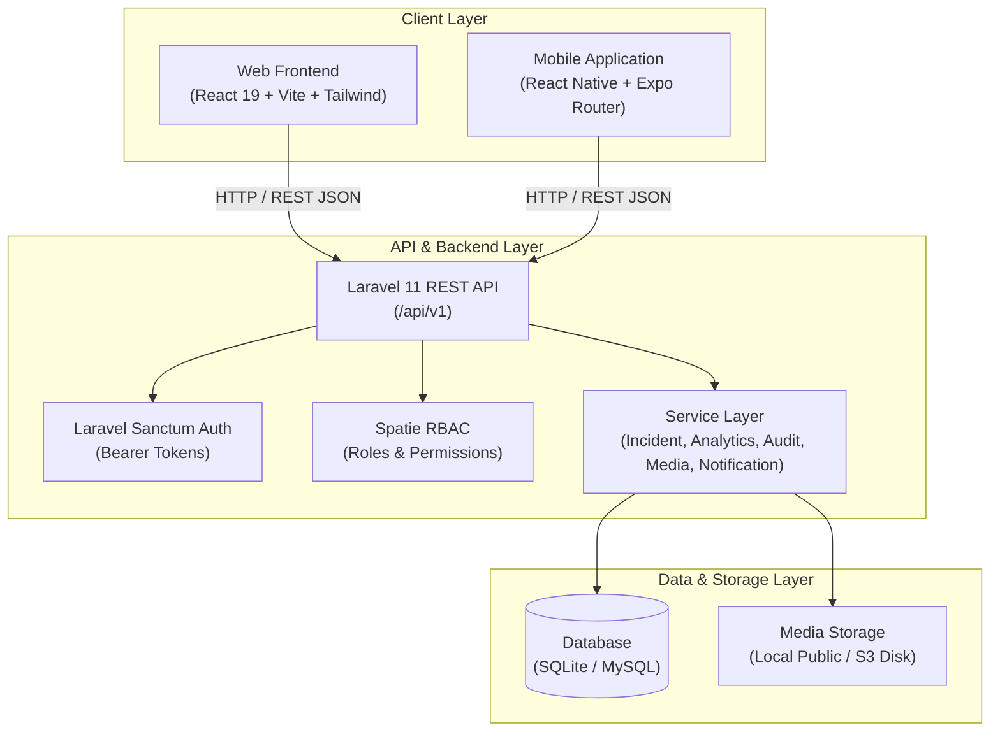
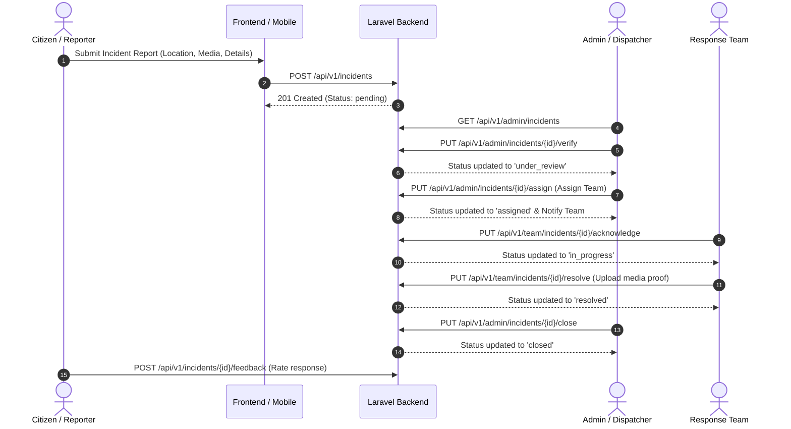
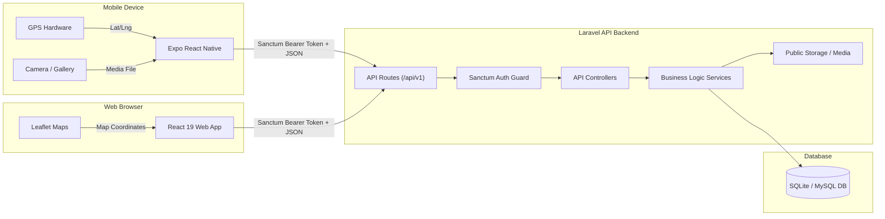

# Community Incident Reporting System (CIR System 3)
## Comprehensive Technical System Documentation

---

## 1. Executive Summary & System Overview

The **Community Incident Reporting System (CIR System 3)** is an end-to-end, multi-platform emergency management and community response platform. It empowers citizens to report public incidents, emergency situations, infrastructure issues, and safety hazards, while equipping administrators and emergency response teams (Fire, Police, Medical, Flood/Disaster) with real-time verification, team dispatch, status tracking, spatial mapping, and analytical capabilities.

### Key Objectives
* **Fast & Flexible Incident Reporting:** Allows authenticated citizens and anonymous users to submit reports complete with precise GPS coordinates, address geocoding, severity levels, categories, and photo/video attachments.
* **Role-Based Workflows:** Distinct user views tailored for **Reporters**, **Response Teams**, **Admins**, and **Super Admins**.
* **Real-Time Verification & Dispatch:** Admins verify incoming incidents, assign specialized response teams, mark duplicates, and publish public updates.
* **Response Team Action Tracking:** Field teams acknowledge assigned incidents, post field updates, upload response media proof, and mark incidents as resolved.
* **Interactive Mapping & Geo-Visualization:** Public and admin geospatial visualization of active incidents filtered by severity, status, and category.
* **Analytical Insights & Audit Trail:** Comprehensive dashboards showing resolution rates, team response performance, category distributions, and immutable audit logs.

---

## 2. System Architecture & Component Overview

The system is structured as a decoupled **3-Tier Architecture**:



### High-Level Incident Lifecycle Flow



---

## 3. Backend Documentation (Laravel 11 Framework)

### 3.1 Technology Stack
* **Language / Environment:** PHP 8.2+
* **Framework:** Laravel 11.x
* **Authentication:** Laravel Sanctum (Token-based API Authentication)
* **Authorization:** Spatie Laravel-Permission v6 (`super_admin`, `admin`, `response_team`, `reporter`)
* **Database:** SQLite (default for development) / MySQL 8.0+ compatible
* **Architecture Pattern:** Controller-Service-Repository Pattern

### 3.2 Directory Structure
```
Backend/
├── app/
│   ├── Http/
│   │   ├── Controllers/Api/   # API Controllers (Auth, Incident, Admin, Team, Analytics, etc.)
│   │   └── Middleware/        # Throttle & Role Middlewares
│   ├── Models/                # Eloquent ORM Models (12 Entities)
│   ├── Services/              # Business Logic Services
│   │   ├── AnalyticsService.php
│   │   ├── AuditService.php
│   │   ├── IncidentService.php
│   │   ├── MediaService.php
│   │   └── NotificationService.php
│   ├── Notifications/         # Database & Email Notifications
│   └── Policies/              # Authorization Policies
├── config/                    # Laravel Configuration Files
├── database/
│   ├── migrations/            # DB Schema Definitions (17 Migrations)
│   └── seeders/               # Roles, Users, Categories, Teams, Demo Incidents
├── routes/
│   ├── api.php                # REST API Routes (/api/v1)
│   ├── console.php
│   └── web.php
└── setup_db.php               # Database Initializer Script
```

### 3.3 Database Schema & Data Models

#### Key Models & Relationships
1. **`User`**
   - Fields: `id`, `name`, `email`, `phone`, `password`, `profile_photo`, `is_active`, `email_verified_at`
   - Relations: `incidents()` (hasMany), `teams()` (belongsToMany), `auditLogs()` (hasMany).
   - Roles: `super_admin`, `admin`, `response_team`, `reporter`.

2. **`Incident`**
   - Fields: `id`, `reference_number` (e.g. `INC-20260819-XXXX`), `title`, `description`, `category_id`, `reporter_id`, `is_anonymous`, `severity` (`low`, `medium`, `high`, `critical`), `status` (`pending`, `under_review`, `assigned`, `in_progress`, `resolved`, `closed`, `rejected`), `latitude`, `longitude`, `address`, `incident_date`, `reported_at`, `assigned_at`, `resolved_at`, `closed_at`, `rejection_reason`, `admin_notes`, `is_duplicate`, `duplicate_of`.
   - Relations: `category()`, `reporter()`, `media()`, `assignments()`, `activeAssignment()`, `updates()`, `statusHistories()`, `feedback()`.

3. **`Team` & `TeamMember`**
   - Fields: `id`, `name`, `description`, `type` (`Fire`, `Police`, `Medical`, `Flood`, `General`), `is_active`.
   - Pivot `TeamMember`: `team_id`, `user_id`, `is_leader`, `joined_at`.

4. **`IncidentAssignment`**
   - Tracks response team dispatch: `incident_id`, `team_id`, `assigned_by`, `assigned_at`, `acknowledged_at`, `status` (`assigned`, `acknowledged`, `in_progress`, `completed`), `is_active`.

5. **`IncidentUpdate` & `IncidentStatusHistory`**
   - Timeline log of status changes and public/internal progress updates.

6. **`IncidentMedia`**
   - Files attached to incidents: `incident_id`, `file_path`, `file_type` (`image`, `video`, `document`), `file_name`, `uploaded_by`.

7. **`Feedback`**
   - Citizen satisfaction survey: `incident_id`, `user_id`, `rating` (1-5), `comment`.

8. **`Announcement`**
   - System broadcast messages: `title`, `content`, `type` (`info`, `warning`, `emergency`), `start_date`, `end_date`, `is_active`.

9. **`AuditLog`**
   - Super admin system tracking: `user_id`, `action`, `model_type`, `model_id`, `old_values`, `new_values`, `ip_address`, `user_agent`.

### 3.4 API Endpoints Summary (`/api/v1`)

| Module | Method | Endpoint | Access Level | Description |
| :--- | :--- | :--- | :--- | :--- |
| **Auth** | `POST` | `/api/v1/auth/register` | Public | Register new reporter account |
| **Auth** | `POST` | `/api/v1/auth/login` | Public | Authenticate user & get Sanctum token |
| **Auth** | `GET` | `/api/v1/auth/me` | Authenticated | Get current user details & role |
| **Auth** | `PUT` | `/api/v1/auth/profile` | Authenticated | Update profile details |
| **Auth** | `POST` | `/api/v1/auth/anonymous-report` | Public | Submit incident report anonymously |
| **Incidents**| `GET` | `/api/v1/incidents` | Reporter/Admin | List user's reported incidents |
| **Incidents**| `POST` | `/api/v1/incidents` | Authenticated | Submit new incident report |
| **Incidents**| `GET` | `/api/v1/incidents/{id}` | Authenticated | View incident details & timeline |
| **Incidents**| `POST` | `/api/v1/incidents/{id}/media` | Authenticated | Upload media attachment |
| **Incidents**| `POST` | `/api/v1/incidents/{id}/feedback` | Authenticated | Submit satisfaction rating |
| **Response** | `GET` | `/api/v1/team/incidents` | Team/Admin | List incidents assigned to team |
| **Response** | `PUT` | `/api/v1/team/incidents/{id}/acknowledge` | Team/Admin | Acknowledge incident dispatch |
| **Response** | `PUT` | `/api/v1/team/incidents/{id}/update` | Team/Admin | Post team progress update |
| **Response** | `PUT` | `/api/v1/team/incidents/{id}/resolve` | Team/Admin | Mark incident as resolved |
| **Admin** | `GET` | `/api/v1/admin/incidents` | Admin/SuperAdmin| List all system incidents with filters |
| **Admin** | `PUT` | `/api/v1/admin/incidents/{id}/verify` | Admin/SuperAdmin| Verify pending incident |
| **Admin** | `PUT` | `/api/v1/admin/incidents/{id}/assign` | Admin/SuperAdmin| Assign incident to response team |
| **Admin** | `PUT` | `/api/v1/admin/incidents/{id}/status` | Admin/SuperAdmin| Change incident status |
| **Admin** | `GET` | `/api/v1/admin/users` | Admin/SuperAdmin| Manage system users & roles |
| **Admin** | `GET` | `/api/v1/admin/teams` | Admin/SuperAdmin| Manage response teams & members |
| **Admin** | `GET` | `/api/v1/admin/analytics/overview` | Admin/SuperAdmin| Get aggregate dashboard analytics |
| **Admin** | `GET` | `/api/v1/admin/audit-logs` | SuperAdmin | Inspect system audit trail |
| **Public** | `GET` | `/api/v1/map/incidents` | Public | Geospatial incident markers for public map |
| **Public** | `GET` | `/api/v1/announcements` | Public | Active public emergency announcements |

---

## 4. Frontend Documentation (Web Application)

### 4.1 Technology Stack
* **Framework:** React 19.x with Vite 8.x
* **Styling:** Tailwind CSS v4 + Custom Utility Classes
* **Icons:** Lucide React
* **State Management:** Zustand v5 (`useAuthStore`, `useIncidentStore`, `notificationStore`, `uiStore`, `useAnnouncementStore`)
* **Routing:** React Router DOM v7 (Role-protected route guards)
* **HTTP Client:** Axios with dynamic auth header interceptor & error handling
* **Geospatial Mapping:** Leaflet 1.9 & React-Leaflet v5 (Interactive map layers, custom markers, popups)
* **Data Visualization:** Recharts v3 (Bar charts, pie charts, area charts for analytics)
* **Form Handling & Validation:** React Hook Form + Zod validation schemas
* **Notifications:** React Hot Toast

### 4.2 Directory Structure
```
Frontend/
├── public/
└── src/
    ├── api/                   # API Integration Modules (axios instance, auth, admin, incidents, etc.)
    ├── assets/                # Logos, SVG icons, static assets
    ├── components/            # UI Components grouped by domain
    │   ├── admin/             # Verification modals, team assigners, user forms
    │   ├── analytics/         # Recharts wrappers & statistical cards
    │   ├── common/            # Navbar, Sidebar, Footer, LoadingSpinners, Badges
    │   ├── incidents/         # IncidentForm, IncidentCard, IncidentDetailPanel, Timeline
    │   ├── map/               # Leaflet Map Component, Marker Clusters, Filters
    │   ├── modals/            # Modal dialog containers
    │   └── notifications/     # Notification dropdown & feed
    ├── hooks/                 # Custom React hooks (useAuth, useDebounce, etc.)
    ├── layouts/               # AdminLayout, ReporterLayout, TeamLayout, AuthLayout
    ├── pages/                 # Page Components organized by role
    │   ├── admin/             # AdminDashboard, AllIncidentsPage, UsersPage, TeamsPage, AnalyticsPage, etc.
    │   ├── auth/              # LoginPage, RegisterPage, ForgotPasswordPage, ResetPasswordPage
    │   ├── errors/            # NotFoundPage, UnauthorizedPage, ServerErrorPage
    │   ├── public/            # LandingPage, PublicMapPage, AnonymousReportPage
    │   ├── reporter/          # ReporterDashboard, MyIncidentsPage, ReportIncidentPage, ProfilePage
    │   └── team/              # TeamDashboard, AssignedIncidentsPage, IncidentResponsePage
    ├── routes/                # Router Configuration & Guards (ProtectedRoute, RoleRoute)
    ├── store/                 # Zustand Global State Stores
    └── utils/                 # Formatters, Constants, Helpers
```

### 4.3 Key User Modules & Page Workflows

#### 1. Citizen / Reporter Experience
* **Landing Page (`/`):** Dynamic Hero section, active emergency announcements banner, statistics counter, quick action buttons.
* **Public Map (`/map`):** Interactive map showing non-confidential resolved and verified incidents with status/severity filters.
* **Anonymous Incident Submission (`/report-anonymous`):** Allows citizens to submit reports without logging in.
* **Reporter Dashboard (`/dashboard`):** Personal dashboard tracking submitted reports, active status updates, and emergency quick contacts.
* **Report Incident Form (`/incidents/new`):** Multi-step form featuring title, category selector, severity picker, address geocoding, Leaflet location pin drag-and-drop, description, and multi-file attachment uploader.

#### 2. Emergency Response Team Experience
* **Team Dashboard (`/team`):** Dedicated operational dashboard for response units (Fire, Police, Medical, Flood).
* **Assigned Incidents Queue (`/team/incidents`):** Real-time list of incidents dispatched to the user's unit.
* **Incident Response Page (`/team/incidents/:id`):** Full operational detail view containing turn-by-turn coordinate view, operational timeline, progress update poster, field photo proof uploader, and resolution confirmation.

#### 3. Admin & Dispatcher Command Center
* **Admin Dashboard (`/admin`):** High-level view showing active incident count, pending verification queue, emergency status, quick dispatch actions, and analytical summary widgets.
* **Incident Management (`/admin/incidents` & `/admin/incidents/:id`):** Comprehensive table with search/filtering by category, severity, status, date range, and duplicate status. Action suite includes Verify, Reject with reason, Team Dispatch/Reassign, Add Admin Note, Post Public Update, Mark as Duplicate, Close, and Export CSV.
* **User Management (`/admin/users`):** Full user list with role assignment, status toggling (Active/Inactive), and user creation.
* **Team Management (`/admin/teams`):** Unit team creation, leadership designation, member management.
* **Category Management (`/admin/categories`):** Manage incident categories (e.g. Fire, Crime, Medical, Infrastructure, Natural Disaster).
* **Broadcast Announcements (`/admin/announcements`):** Create and post public alert banners visible across web and mobile platforms.
* **Analytics Center (`/admin/analytics`):** Graphical visualization of response times, category distribution, status breakdowns, and team performance metrics.
* **Audit Trail (`/admin/audit-logs`):** Accessible by Super Admin to inspect every system state modification.

---

## 5. Mobile Documentation (React Native & Expo Application)

### 5.1 Technology Stack
* **Framework:** React Native 0.81.5 with Expo SDK 54
* **Navigation Engine:** Expo Router v6 (File-based router supporting route groups `(auth)`, `(reporter)`, `(admin)`, `(team)`)
* **State Management:** Zustand v5 (`authStore`, `notificationStore`)
* **Persistence:** `@react-native-async-storage/async-storage` for local token and user caching
* **Device Capabilities:**
  * `expo-location`: Device GPS coordinate extraction for precise report tagging
  * `expo-image-picker`: Camera capture & gallery selection for incident evidence
  * `expo-constants` & `expo-linking`: System deep-linking and app configuration
* **Icons & UI:** `lucide-react-native`, `react-native-safe-area-context`, `react-native-svg`

### 5.2 Directory Structure
```
Mobile/
├── app/                       # Expo Router File-Based Navigation Pages
│   ├── (admin)/               # Admin Mobile Workflows
│   │   ├── _layout.jsx        # Admin Tab / Stack Layout
│   │   ├── index.jsx          # Admin Mobile Overview
│   │   ├── analytics.jsx      # Mobile Analytics View
│   │   ├── users.jsx          # User Status Management
│   │   └── verification.jsx   # Quick Mobile Incident Verification Queue
│   ├── (auth)/                # Mobile Auth Pages
│   │   ├── _layout.jsx
│   │   ├── login.jsx          # Login Screen
│   │   ├── register.jsx       # Citizen Registration Screen
│   │   └── forgot-password.jsx# Password Reset Screen
│   ├── (reporter)/            # Citizen Reporter Workflows
│   │   ├── [id].jsx           # Mobile Incident Detail & Timeline Screen
│   │   ├── _layout.jsx        # Reporter Bottom Tab Bar Layout
│   │   ├── incidents.jsx      # My Incidents List Screen
│   │   ├── index.jsx          # Reporter Home Dashboard
│   │   ├── map.jsx            # Native Geospatial Incident Map
│   │   ├── profile.jsx        # User Profile & Dark Mode Settings Screen
│   │   └── report.jsx         # Mobile Incident Report Form (GPS & Camera Integration)
│   ├── (team)/                # Response Team Workflows
│   │   ├── _layout.jsx        # Team Stack Layout
│   │   ├── index.jsx          # Team Assigned Incidents Queue
│   │   └── response.jsx       # Mobile Field Action & Status Update Screen
│   ├── _layout.jsx            # Root Application Layout & Store Hydration
│   ├── index.jsx              # App Entry Point & Auth Redirect Handler
│   └── notifications.jsx      # Notifications Screen
├── src/
│   ├── api/                   # Mobile Axios Client (`client.js` with auto-detected IP fallback)
│   ├── components/            # Reusable Native Cards, Badges, Buttons, Inputs
│   ├── store/                 # Native Zustand State Stores (`authStore`, `notificationStore`)
│   ├── theme/                 # Mobile Colors, Typography, Spacing Design Tokens
│   └── utils/                 # Date formatters, location helpers
├── app.json                   # Expo Project Configuration
└── package.json               # Dependencies & Scripts
```

### 5.3 Mobile Key Features & Native Integrations
1. **Automatic Device GPS Detection:** One-tap location capture in the incident report screen populates exact latitude and longitude coordinates.
2. **Camera & Photo Gallery Pickers:** Native media picker enables field reporters and response teams to capture photo proof directly or attach images from device storage.
3. **Role-Based Dynamic Mobile Routing:** Upon authentication, Expo Router dynamically routes users to their respective section (`(reporter)`, `(team)`, or `(admin)`).
4. **Offline Auth Caching:** User tokens stored securely in `AsyncStorage` facilitate seamless session persistence across app launches.

---

## 6. End-to-End System Integration & Data Flow



---

## 7. Development & Deployment Setup Guide

### 7.1 System Requirements
* **Node.js:** v18.0.0 or higher
* **PHP:** v8.2.0 or higher
* **Composer:** v2.5.0 or higher
* **Expo CLI:** `npx expo`

---

### 7.2 Backend Installation & Setup

1. **Navigate to the Backend directory:**
   ```bash
   cd Backend
   ```

2. **Install PHP dependencies:**
   ```bash
   composer install
   ```

3. **Configure Environment File:**
   Copy `.env.example` to `.env` if not already created:
   ```bash
   cp .env.example .env
   ```
   Ensure SQLite database path or MySQL settings are properly configured in `.env`:
   ```env
   DB_CONNECTION=sqlite
   # DB_DATABASE=database/database.sqlite
   ```

4. **Generate Application Encryption Key:**
   ```bash
   php artisan key:generate
   ```

5. **Run Migrations & Database Seeders:**
   ```bash
   php artisan migrate:fresh --seed
   ```

6. **Create Storage Symbolic Link:**
   ```bash
   php artisan storage:link
   ```

7. **Start the Laravel Development Server:**
   ```bash
   php artisan serve
   ```
   *Backend API will run at `http://127.0.0.1:8000/api/v1`.*

---

### 7.3 Web Frontend Installation & Setup

1. **Navigate to the Frontend directory:**
   ```bash
   cd Frontend
   ```

2. **Install Node.js dependencies:**
   ```bash
   npm install
   ```

3. **Configure Environment File:**
   Create a `.env` file in `Frontend/` with the API base URL:
   ```env
   VITE_API_BASE_URL=http://127.0.0.1:8000/api/v1
   ```

4. **Start the Vite Development Server:**
   ```bash
   npm run dev
   ```
   *Frontend application will be accessible at `http://localhost:5173`.*

---

### 7.4 Mobile Application Installation & Setup

1. **Navigate to the Mobile directory:**
   ```bash
   cd Mobile
   ```

2. **Install Mobile Node.js dependencies:**
   ```bash
   npm install
   ```

3. **Configure Mobile API Base URL:**
   Update `src/api/client.js` or `.env` with your computer's local IP address (for physical device / emulator testing):
   ```javascript
   const API_BASE_URL = 'http://192.168.x.x:8000/api/v1'; // Replace with local network IP
   ```

4. **Start the Expo Development Server:**
   ```bash
   npx expo start
   ```
   - Press `a` to launch Android Emulator.
   - Press `w` to launch Web preview.
   - Scan QR code using **Expo Go** app on iOS/Android device.

---

## 8. Seeded Credentials & Demo Accounts

For local testing and demonstration purposes, the database seeder populates the system with pre-configured accounts across all user roles:

| User Role | Name | Email | Password |
| :--- | :--- | :--- | :--- |
| **Super Admin** | System Super Admin | `superadmin@cir.org` | `Password@123` |
| **Super Admin** | Super Admin | `superadmin@community.com` | `Password@123` |
| **Admin** | System Admin | `admin@community.com` | `Password@123` |
| **Admin** | Commander Sarah Jenkins | `admin@cir.org` | `Password@123` |
| **Response Team** (Fire Lead)| Captain David Vance | `fire.captain@cir.org` | `Password@123` |
| **Response Team** (Police Lead)| Inspector Marcus Reed | `police.lead@cir.org` | `Password@123` |
| **Citizen Reporter** | Alex Morgan | `citizen.alex@cir.org` | `Password@123` |
| **Citizen Reporter** | Taylor Swift | `citizen.taylor@cir.org` | `Password@123` |

---

## 9. Security & Best Practices

1. **Token Authentication:** Secure API access via Laravel Sanctum bearer tokens with fine-grained expiration policies.
2. **Role-Based Middleware Authorization:** Every route strictly guarded by Spatie permissions preventing unauthorized cross-role access.
3. **Rate Limiting:** Public authentication routes throttled (`throttle:5,1`) to prevent brute-force attacks.
4. **Input Validation:** Backend form requests and Frontend Zod schemas rigorously sanitize all inputs, latitude/longitude bounds, and media file types.
5. **Audit Logging:** System state changes logged with IP address, user ID, timestamp, and before/after state diffs for auditability.
