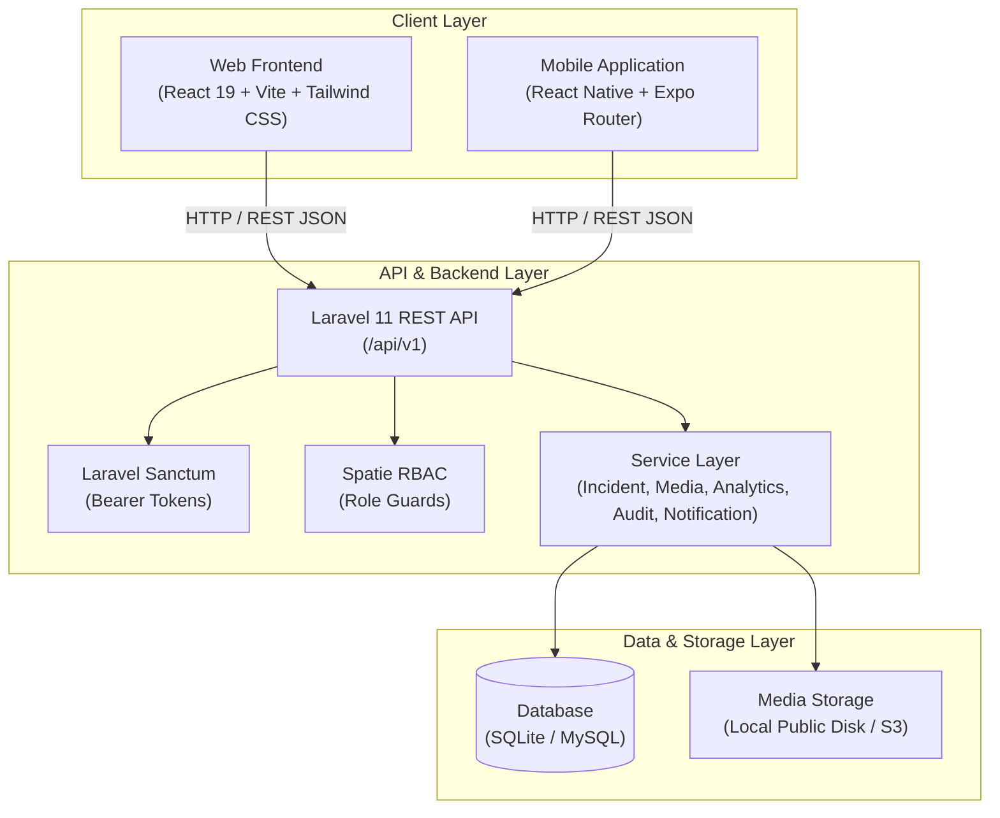
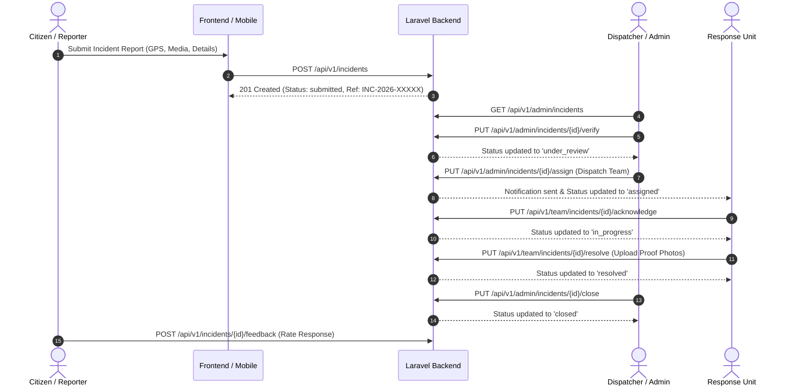

# 🚨 Community Incident Reporting System (CIR System)

[](https://laravel.com)
[](https://react.dev)
[](https://vitejs.dev)
[](https://reactnative.dev)
[](https://expo.dev)
[](https://tailwindcss.com)
[](https://leafletjs.com)

An end-to-end, multi-platform emergency management and community response platform. **CIR System** empowers citizens to report public incidents, hazards, and emergency situations in real time while providing emergency dispatchers, municipal administrators, and first response teams (**Fire, Police, Medical EMS, Flood/Disaster Relief**) with tactical dispatch tools, geospatial radars, live tracking, and compliance analytics.

---

## 📑 Table of Contents

- [Key System Capabilities](#-key-system-capabilities)
- [System Architecture](#-system-architecture)
- [Tech Stack Overview](#-tech-stack-overview)
- [Project Directory Structure](#-project-directory-structure)
- [Getting Started & Installation](#-getting-started--installation)
  - [Prerequisites](#prerequisites)
  - [1. Backend Setup (Laravel 11 API)](#1-backend-setup-laravel-11-api)
  - [2. Frontend Setup (React 19 Web Application)](#2-frontend-setup-react-19-web-application)
  - [3. Mobile App Setup (React Native + Expo)](#3-mobile-app-setup-react-native--expo)
- [Demo Accounts & Seed Credentials](#-demo-accounts--seed-credentials)
- [REST API Reference Summary](#-rest-api-reference-summary)
- [Security & Architectural Best Practices](#-security--architectural-best-practices)
- [License](#-license)

---

## 🌟 Key System Capabilities

### 📢 1. Citizen & Public Reporter Experience
- **Multi-Step Incident Reporting:** Intuitive form with taxonomy classification, severity assessment, GPS coordinate auto-detection, address geocoding, and photo evidence upload.
- **Anonymous Reporting Support:** Report hazards securely without creating an account or logging in.
- **Public Incident Progress Tracker (`/track/:ref`):** Look up any incident status via reference code (`INC-2026-XXXXX`) with a live 6-stage progress timeline, assigned response unit information, and public field update logs.
- **Live Geospatial Radar Map (`/map`):** Interactive Leaflet heatmap and marker view with category/severity filters and a 1-tap *"Locate Near Me"* GPS finder.
- **Emergency Hotline Directory & Safety Guides (`/emergency-contacts`):** Direct 1-tap speed dials for **911**, **Fire (101)**, **EMS (102)**, **Police (100)**, and **Disaster Bureau**, paired with standard emergency survival guides.

### 🛡️ 2. First Response Team Experience (Fire, Police, EMS, Disaster)
- **Dedicated Team Dashboard (`/team`):** Centralized dispatch queue displaying active, acknowledged, and pending tasks.
- **Mobile Field Operations View (`/team/incidents/:id/field`):** High-contrast tactical mobile interface with:
  - 1-tap turn-by-turn GPS routing into Google Maps / Waze.
  - Rapid status action buttons: `Acknowledge` $\rightarrow$ `En Route` $\rightarrow$ `On Scene` $\rightarrow$ `Resolve`.
  - On-site evidence photo upload and resolution summary logger.

### ⚡ 3. Administration & Dispatch Command Center
- **Live Dispatch Command Center (`/admin/dispatch`):** Full-screen tactical radar with real-time incident pins, severity color coding, active incident queue, and 1-click unit dispatch/reassignment modal.
- **Master Incident Triage (`/admin/incidents`):** Comprehensive queue to verify, reject with reason, reassign, add internal notes, post public updates, and mark duplicate reports.
- **Compliance & SLA Reports Center (`/admin/reports`):** Key metrics calculation for **Mean Time to Acknowledge (MTTA)** and **Mean Time to Resolve (MTTR)**, with print-to-PDF layout and full CSV data export.
- **User & Team Management:** RBAC role management (Super Admin, Admin, Response Team, Reporter), unit creation, and leadership assignment.
- **Broadcast Announcements (`/admin/announcements`):** Publish emergency alert banners across web and mobile apps.
- **Security Audit Logs (`/admin/audit-logs`):** Immutable log of every system mutation, role change, IP address, and dispatcher action.

---

## 🏗️ System Architecture

CIR System 3 is designed around a decoupled **3-Tier Architecture**:



### High-Level Incident Lifecycle Flow



---

## 💻 Tech Stack Overview

| Domain | Technology | Description |
| :--- | :--- | :--- |
| **Backend API** | **Laravel 11.x** (PHP 8.2+) | High-performance RESTful API with Controller-Service-Repository architecture |
| **Authentication** | **Laravel Sanctum** | Secure token-based API authentication |
| **Authorization** | **Spatie Laravel-Permission v6** | Granular role-based access control (`super_admin`, `admin`, `response_team`, `reporter`) |
| **Database** | **SQLite / MySQL 8.0+** | Relational schema with 17 database migrations & seeders |
| **Web Frontend** | **React 19 + Vite 8** | Ultra-fast modern single-page web application |
| **Web Styling** | **Tailwind CSS v4** | Modern dark-mode optimized design tokens and utilities |
| **Mobile App** | **React Native + Expo SDK 54** | Cross-platform native mobile app (iOS & Android) with Expo Router |
| **Mapping Engine** | **Leaflet 1.9 & React-Leaflet** | Interactive geospatial mapping, custom markers, and location pickers |
| **State Management**| **Zustand v5** | Lightweight, decoupled global state stores |
| **Data Viz** | **Recharts v3** | Interactive analytical charts, response curves, and SLA breakdowns |
| **Validation** | **React Hook Form + Zod** | Client-side & schema-level input validation |

---

## 📁 Project Directory Structure

```
CIR_System_3/
├── Backend/                   # Laravel 11 API Backend
│   ├── app/
│   │   ├── Http/Controllers/Api/ # Auth, Incident, Admin, Team, Analytics, etc.
│   │   ├── Models/            # Eloquent ORM Models (12 Entities)
│   │   ├── Notifications/     # System & Email Notification Classes
│   │   └── Services/          # IncidentService, AnalyticsService, AuditService, MediaService
│   ├── database/
│   │   ├── migrations/        # 17 DB Migrations
│   │   └── seeders/           # Roles, Users, Categories, Teams, Demo Incidents
│   └── routes/
│       └── api.php            # REST API Route Definitions (/api/v1)
│
├── Frontend/                  # React 19 + Vite Web Application
│   └── src/
│       ├── api/               # Axios API modules (admin, auth, incidents, team, analytics)
│       ├── components/        # UI components (maps, incidents, admin, analytics, common)
│       ├── layouts/           # AdminLayout, TeamLayout, ReporterLayout
│       ├── pages/             # Pages organized by domain (public, auth, admin, reporter, team)
│       ├── routes/            # React Router v7 configuration & RoleRoute guards
│       ├── store/             # Zustand global state stores
│       └── utils/             # Demo data, formatters, validators
│
├── Mobile/                    # React Native + Expo Application
│   ├── app/                   # Expo Router file-based screens ((auth), (reporter), (admin), (team))
│   └── src/                   # Native components, Zustand stores, API clients
│
├── Documentation.md           # Comprehensive technical architecture document
└── README.md                  # Project overview & quickstart guide
```

---

## 🚀 Getting Started & Installation

### Prerequisites
Make sure your environment meets the following requirements:
- **Node.js:** `>= 18.0.0`
- **PHP:** `>= 8.2.0` with `sqlite3`, `pdo`, `mbstring`, `openssl`, `curl` extensions enabled
- **Composer:** `>= 2.5.0`
- **Expo CLI:** `npx expo` (for mobile app)

---

### 1. Backend Setup (Laravel 11 API)

1. Open your terminal and enter the `Backend` directory:
   ```bash
   cd Backend
   ```

2. Install PHP dependencies:
   ```bash
   composer install
   ```

3. Configure environment settings:
   ```bash
   cp .env.example .env
   ```
   *By default, SQLite is pre-configured in `.env` (`DB_CONNECTION=sqlite`).*

4. Generate application key:
   ```bash
   php artisan key:generate
   ```

5. Run database migrations and seed demo data:
   ```bash
   php artisan migrate:fresh --seed
   ```

6. Link public storage disk for media attachments:
   ```bash
   php artisan storage:link
   ```

7. Start the Laravel development server:
   ```bash
   php artisan serve
   ```
   > 📡 Backend API runs at: `http://127.0.0.1:8000/api/v1`

---

### 2. Frontend Setup (React 19 Web Application)

1. In a new terminal window, navigate to `Frontend`:
   ```bash
   cd Frontend
   ```

2. Install Node.js dependencies:
   ```bash
   npm install
   ```

3. Configure the frontend `.env` file (if not already present):
   ```env
   VITE_API_BASE_URL=http://127.0.0.1:8000/api/v1
   ```

4. Start the Vite development server:
   ```bash
   npm run dev
   ```
   > 🌐 Web Application accessible at: `http://localhost:5173`

---

### 3. Mobile App Setup (React Native + Expo)

1. In a new terminal window, navigate to `Mobile`:
   ```bash
   cd Mobile
   ```

2. Install dependencies:
   ```bash
   npm install
   ```

3. Start the Expo development server:
   ```bash
   npx expo start
   ```
   - Press `w` in terminal for Web preview.
   - Press `a` to run on an active Android emulator.
   - Scan the terminal QR code with the **Expo Go** app on your physical iOS/Android phone.

---

## 🔑 Demo Accounts & Seed Credentials

The database seeder pre-populates all user roles with demo credentials for instant testing:

| Role | Name / Unit | Email | Password |
| :--- | :--- | :--- | :--- |
| **Super Admin** | System Super Admin | `superadmin@cir.org` | `Password@123` |
| **Admin** | Commander Sarah Jenkins | `admin@cir.org` | `Password@123` |
| **Admin** | System Dispatcher | `admin@community.com` | `Password@123` |
| **Response Team** *(Fire Lead)* | Captain David Vance | `fire.captain@cir.org` | `Password@123` |
| **Response Team** *(Police Lead)* | Inspector Marcus Reed | `police.lead@cir.org` | `Password@123` |
| **Citizen Reporter** | Alex Morgan | `citizen.alex@cir.org` | `Password@123` |
| **Citizen Reporter** | Taylor Swift | `citizen.taylor@cir.org` | `Password@123` |

> 💡 **Tip:** The web navbar includes an interactive **Role Switcher** pill in the top right to instantly test Super Admin, Admin, Response Team, and Citizen Reporter views with one click!

---

## 📡 REST API Reference Summary

All endpoints are versioned under `/api/v1`.

### 🔓 Public Endpoints
| Method | Endpoint | Description |
| :--- | :--- | :--- |
| `POST` | `/api/v1/auth/register` | Register new citizen reporter |
| `POST` | `/api/v1/auth/login` | Authenticate user & receive Sanctum bearer token |
| `POST` | `/api/v1/auth/anonymous-report` | Submit an incident report anonymously |
| `GET` | `/api/v1/incidents/track/{ref}` | Public incident status lookup by reference number |
| `GET` | `/api/v1/map/incidents` | Geospatial incident markers for public radar map |
| `GET` | `/api/v1/announcements` | Active emergency public broadcast announcements |

### 🔒 Authenticated Reporter Endpoints
| Method | Endpoint | Description |
| :--- | :--- | :--- |
| `GET` | `/api/v1/incidents` | List user's submitted incident reports |
| `POST` | `/api/v1/incidents` | Create a new incident report with file attachments |
| `GET` | `/api/v1/incidents/{id}` | Retrieve full incident details, media, and timeline |
| `POST` | `/api/v1/incidents/{id}/feedback` | Submit resolution satisfaction rating (1-5 stars + comment) |

### 🚒 Response Team Endpoints (`role:response_team|admin|super_admin`)
| Method | Endpoint | Description |
| :--- | :--- | :--- |
| `GET` | `/api/v1/team/incidents` | List incidents dispatched to user's assigned response unit |
| `PUT` | `/api/v1/team/incidents/{id}/acknowledge` | Acknowledge dispatch & set status to `in_progress` |
| `PUT` | `/api/v1/team/incidents/{id}/update` | Post live field status update |
| `PUT` | `/api/v1/team/incidents/{id}/resolve` | Resolve incident & upload photographic completion proof |

### 🛡️ Admin & Dispatcher Endpoints (`role:admin|super_admin`)
| Method | Endpoint | Description |
| :--- | :--- | :--- |
| `GET` | `/api/v1/admin/incidents` | Master incident queue with advanced filtering |
| `PUT` | `/api/v1/admin/incidents/{id}/verify` | Verify incoming incident report |
| `PUT` | `/api/v1/admin/incidents/{id}/reject` | Reject incident with explanation reason |
| `PUT` | `/api/v1/admin/incidents/{id}/assign` | Assign incident to specialized emergency team |
| `PUT` | `/api/v1/admin/incidents/{id}/duplicate` | Mark incident as duplicate of master ticket |
| `GET` | `/api/v1/admin/incidents/export` | Download complete incident dataset as CSV |
| `GET` | `/api/v1/admin/users` | User directory management & role assignment |
| `GET` | `/api/v1/admin/teams` | Response unit management & member assignment |
| `GET` | `/api/v1/admin/analytics/overview` | Executive analytics dashboard figures |
| `GET` | `/api/v1/admin/audit-logs` | Immutable security audit trail *(Super Admin only)* |

---

## 🔒 Security & Architectural Best Practices

1. **Sanctum Token Authentication:** Token-based bearer authentication with automated Axios header injection.
2. **Spatie RBAC Authorization:** Middleware guards enforce strict role separation between citizens, responders, and administrators.
3. **Brute-Force Rate Limiting:** Public auth and report endpoints protected by request throttles (`throttle:5,1`).
4. **Input Sanitization & Schema Validation:** Laravel FormRequests on backend + Zod schemas on frontend guarantee boundary enforcement on all parameters, coordinates, and attachments.
5. **Security Audit Logging:** All state mutations, verifications, and dispatches log actor ID, IP address, user agent, and timestamp.

---

## 📄 License

This project is open-sourced software licensed under the [MIT License](https://opensource.org/licenses/MIT).
